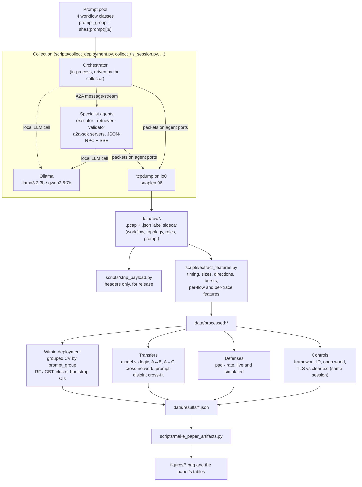
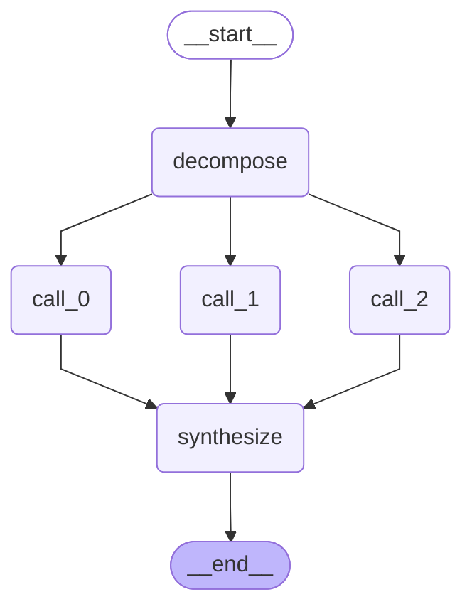
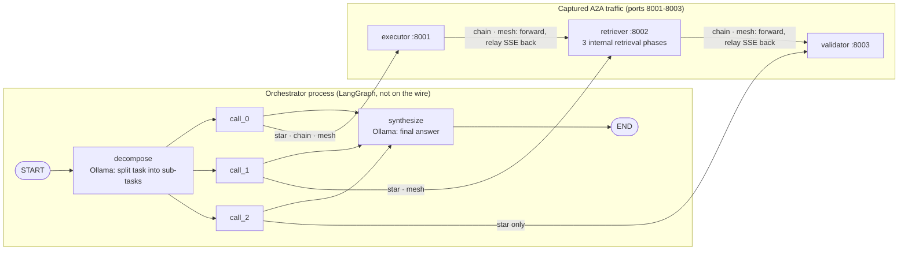
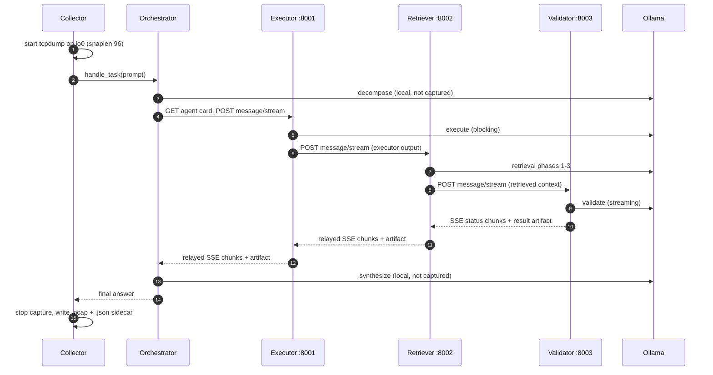

# Workflow diagrams

Mermaid diagrams of how the study runs, from one task to a figure in the paper.
GitHub and VS Code (with a Mermaid preview) render them in place.

1. [Study pipeline](#1-study-pipeline): collection → features → evaluation → paper artifacts
2. [Deployment C orchestrator (LangGraph)](#2-deployment-c-orchestrator-langgraph): the `StateGraph`
   exported by LangGraph itself, and how its nodes map onto A2A calls per topology
3. [One traced task](#3-one-traced-task-chain-topology): what crosses the wire in a chain run

## 1. Study pipeline

## 2. Deployment C orchestrator (LangGraph)

Deployment C keeps A's specialist agents, prompts and model, and replaces only the
orchestrator's fan-out with a LangGraph `StateGraph`
([agents_langgraph/orchestrator_langgraph.py](../agents_langgraph/orchestrator_langgraph.py)).
`decompose` and `synthesize` are local Ollama calls that never reach the captured wire; each
`call_i` node is one A2A streaming call to a specialist, which is the traffic the observer sees.

### As exported by LangGraph

Generated by `python scripts/export_langgraph_mermaid.py`
(`get_graph().draw_mermaid()`; files in [docs/diagrams/](diagrams/)). Star topology:

Chain has a single `call_0` and mesh has `call_0` and `call_1`
([langgraph_chain.mmd](diagrams/langgraph_chain.mmd), [langgraph_mesh.mmd](diagrams/langgraph_mesh.mmd)).
The edges out of `decompose` run in one parallel superstep; the edges into `synthesize`
are the fan-in barrier, and the `results` channel's additive reducer collects each branch's output.

### Mapped onto agents and the wire

The LangGraph graph stops at the orchestrator. What happens after each `call_i` is
decided by the specialist agents' routing, which differs per topology:

| Topology | Orchestrator calls (`call_i`) | Specialist-to-specialist hops |
|---|---|---|
| star | executor, retriever, validator (all leaves) | none |
| chain | executor | executor → retriever → validator |
| mesh | executor, retriever | executor → retriever → validator (retriever has two inbound flows) |

## 3. One traced task (chain topology)

Every arrow between agents is an HTTP request on a captured port; the SSE replies stream back
along the same connections. The capture keeps packet headers only, so the observer sees
timing, sizes and direction of these exchanges, never their content.

